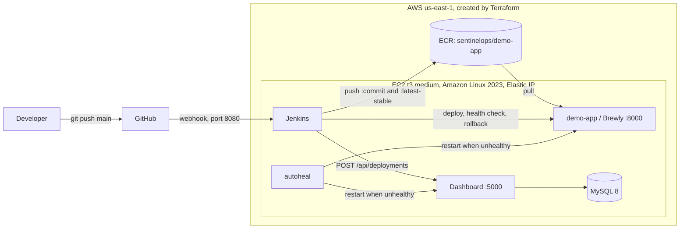

# SentinelOps

A self-healing CI/CD pipeline on AWS. Every push to `main` is tested, built into
a Docker image tagged with its Git commit, scanned with Trivy, pushed to Amazon
ECR and deployed to EC2 by Jenkins. If the new version fails its health check,
the pipeline rolls back to the last stable image by itself. Crashed or hung
containers restart themselves, and every deployment is reported to a web
dashboard that traces it back to its commit.

The deployed app is **Brewly**, a small website for a fictional coffee shop.
Its footer shows the version, commit and container it is running, so every
deploy and every rollback is visible in the browser.

## Architecture



One EC2 server runs everything: Jenkins, Docker, the dashboard stack and the
deployed demo-app. Terraform (`terraform/`) creates:

| Resource | Details |
|---|---|
| EC2 instance | t3.medium, Amazon Linux 2023, 30 GB gp3, IMDSv2 required. `user_data.sh` installs Docker, Compose, Jenkins, Trivy, python3.11, jq and git on first boot |
| Elastic IP | fixed public IP that survives stop/start |
| Security group | 22 (SSH) from my IP only. 8080 (Jenkins) open so GitHub webhooks can reach it, protected by the Jenkins login. 5000 (dashboard) and 8000 (demo-app) open |
| ECR repository | `sentinelops/demo-app`, scan on push, lifecycle policy keeps the last 10 images |

AWS access on the server comes from the AWS Academy Learner Lab's existing
`LabInstanceProfile` (the lab doesn't allow creating IAM roles). No AWS keys are
stored on the server, in Jenkins or in the repo.

## The pipeline

[`Jenkinsfile`](Jenkinsfile) (declarative), triggered by the GitHub webhook on
every push to `main`:

| # | Stage | What happens |
|---|---|---|
| 1 | Checkout | Clones the commit and records hash, author, message and commit time |
| 2 | Test | pytest for demo-app in a python3.11 venv; JUnit results published, coverage XML archived |
| 3 | Build | `docker build`, image tagged with the short commit SHA and labelled with the full commit and build number |
| 4 | Scan | Trivy image scan, fails on fixable HIGH/CRITICAL vulnerabilities; report archived |
| 5 | Push | Logs in with `aws ecr get-login-password` and pushes the image to ECR |
| 6 | Deploy | [`scripts/deploy.sh`](scripts/deploy.sh) replaces the `demo-app` container on port 8000 |
| 7 | Health check | [`scripts/healthcheck.sh`](scripts/healthcheck.sh) calls `/health` up to 5 times, 5 s apart |

- **Healthy:** the image is also tagged `latest-stable` in ECR. It becomes the version to roll back to.
- **Unhealthy:** [`scripts/rollback.sh`](scripts/rollback.sh) redeploys `latest-stable` and checks its health again. The build ends UNSTABLE and is reported as ROLLED_BACK.
- **Always:** [`scripts/report.sh`](scripts/report.sh) posts the result (commit, author, branch, build number, image tag, status, duration, failed stage) to the dashboard. A failed report never fails the build. The workspace is then cleaned.

Two build parameters exist for the demos: `BREAK_HEALTH` deploys a version
whose `/health` returns 500, to show the rollback. `DOCKERFILE=Dockerfile.vulnerable`
builds on an old base image, to show Trivy blocking the build. The dashboard
token is a Jenkins "Secret text" credential, masked in logs. Options:
timestamps, build discarder, 30-minute timeout.

## Self-healing

| Level | Failure | What heals it |
|---|---|---|
| Application | A new version fails `/health` after deploy | Jenkins runs `rollback.sh`: the `latest-stable` image from ECR is redeployed and re-checked |
| Container: crash | The app process exits | Docker restart policy `unless-stopped` starts it again |
| Container: hang | The process runs but `/health` fails | Docker `HEALTHCHECK` marks the container unhealthy, the [autoheal](https://github.com/willfarrell/docker-autoheal) container restarts it |

On the first deploy there is no `latest-stable` yet, so `rollback.sh` stops with a
clear message and the build fails instead of rolling back.

## Security gate: Trivy

Every image is scanned before it is pushed:

```bash
trivy image --severity HIGH,CRITICAL --ignore-unfixed --exit-code 1 <image>
```

`--ignore-unfixed` skips CVEs that have no fix yet (otherwise the pipeline would
stay red for problems nobody can patch). Both Dockerfiles use `python:3.11-slim`,
install Debian security updates, remove `setuptools` (it bundles old packages
with HIGH CVEs) and run as a non-root user. `demo-app/Dockerfile.vulnerable` is
kept only to demonstrate the gate: it fails the scan, so it is never pushed or
deployed. Scan results: [docs/docker.md](docs/docker.md#image-scanning-with-trivy).

## The two apps

**demo-app (Brewly)** is the app the pipeline deploys. It's a Flask app with plain
HTML/CSS templates and no JavaScript.

- Pages: `/` (home), `/menu`, `/about`. The footer shows `Version <APP_VERSION> · commit <short GIT_COMMIT> · container <hostname>`.
- `/health`: 200, or 500 when `BREAK_HEALTH=true` or while `/tmp/break-health` exists (that file is removed when the app starts, so a restart fixes it).
- `/api/info`: version, commit and hostname as JSON.
- Runs with gunicorn on port 8000. 35 pytest tests.

**Dashboard** tracks every deployment. It uses Flask, Flask-Login, Flask-WTF,
Flask-SQLAlchemy, MySQL 8, Bootstrap 5 and Chart.js, all served locally with no CDN.

- Login, register and logout, with hashed passwords and CSRF protection on every form.
- Overview: total deployments, success rate, rollbacks, open incidents, deployment frequency, MTTR, lead time (commit to deploy), and charts of deployments per day and by status.
- Services (create, edit, delete), Deployments (status filter, detail page with the full trace and a stage timeline), Incidents (create, edit root cause, resolve, delete).
- REST API: `POST /api/deployments` (needs the `X-API-Token` header, compared in constant time), `GET /api/deployments`, `GET /api/stats`, `GET /health`. A deployment reported as FAILED or ROLLED_BACK opens an incident automatically.
- `seed.py` adds demo data marked `is_seed` (the UI shows a "demo data" note). `seed.py --clear` removes it and keeps real pipeline data.
- 106 pytest tests.

## Project structure

```
sentinelops/
├── dashboard/                # Flask dashboard: UI, REST API, DB models, 106 tests
│   ├── app/                  # app factory, models, metrics, routes, templates, static
│   ├── tests/
│   ├── seed.py               # demo data (is_seed), --clear removes it
│   ├── wsgi.py
│   └── Dockerfile
├── demo-app/                 # Brewly website, the app the pipeline deploys
│   ├── app.py                # pages, /health, /api/info, menu data
│   ├── templates/  static/   # HTML pages and one stylesheet
│   ├── tests/                # 35 tests
│   ├── Dockerfile
│   └── Dockerfile.vulnerable # old base image, only for the Trivy demo
├── Jenkinsfile               # the pipeline
├── scripts/
│   ├── deploy.sh             # replace the demo-app container with a new image
│   ├── healthcheck.sh        # GET /health with retries
│   ├── rollback.sh           # redeploy latest-stable and re-check health
│   └── report.sh             # POST the result to the dashboard API
├── terraform/                # EC2, Elastic IP, security group, ECR (+ user_data.sh)
├── docs/
│   ├── docker.md             # images, compose files, self-healing tests, Trivy results
│   └── jenkins-setup.md      # server setup, Jenkins job, webhook, demo steps
├── docker-compose.yml        # local: MySQL + dashboard + demo-app + autoheal
├── docker-compose.prod.yml   # EC2: MySQL + dashboard + autoheal (demo-app comes from Jenkins)
├── .env.example              # settings, copy to .env (never committed)
└── .gitattributes            # LF line endings for scripts, Terraform, Docker, YAML
```

## Tech stack

| Area | Tools |
|---|---|
| Apps | Python 3.11, Flask, gunicorn, Jinja; dashboard also uses Flask-Login, Flask-WTF, Flask-SQLAlchemy, Bootstrap 5, Chart.js |
| Database | MySQL 8 in Docker; SQLite for quick local runs and unit tests |
| Quality and security | pytest + coverage, flake8, Trivy image scan, ECR scan on push |
| Containers | Docker (slim images, non-root user, HEALTHCHECK), Docker Compose, autoheal |
| CI/CD | Jenkins declarative pipeline, GitHub webhook |
| Infrastructure as Code | Terraform, AWS provider 6 |
| AWS | EC2, Elastic IP, Security Group, ECR, Learner Lab instance profile |

## Run locally

Needs Docker Desktop. Commands are for Windows PowerShell, from the repository root.

```powershell
Copy-Item .env.example .env       # then fill in the values (instructions inside the file)
docker compose up --build -d      # MySQL + dashboard + demo-app + autoheal
docker compose ps                 # all four "(healthy)" after about 30 s
```

- Dashboard: http://localhost:5000. Register an account, or load demo data with `docker compose exec dashboard python seed.py` (login `admin` / `sentinel-demo`).
- Brewly: http://localhost:8000

Stop with `docker compose down` (data is kept in the `mysql-data` volume; `down -v` deletes it).

### Without Docker (dashboard only, SQLite)

```powershell
python -m venv .venv
.venv\Scripts\Activate.ps1
pip install -r dashboard\requirements-dev.txt
cd dashboard
python seed.py        # optional demo data
python wsgi.py        # http://127.0.0.1:5000
```

Without `DATABASE_URL` the dashboard uses a SQLite file in `dashboard\instance\`.

### Tests and lint

```powershell
cd dashboard; python -m pytest; python -m flake8 .; cd ..
cd demo-app;  pip install -r requirements-dev.txt; python -m pytest; python -m flake8; cd ..
```

### Report a deployment by hand

This is the request Jenkins sends. Use the `API_TOKEN` from `.env`. The service must
exist on the Services page.

```powershell
$body = @{ service = "demo-app"; commit_hash = "7c1e4b9d2f0a8e6b5c3d1f4a9b8e7d6c5b4a3f21"
           status = "ROLLED_BACK"; build_number = 48; branch = "main" } | ConvertTo-Json
Invoke-RestMethod -Method Post -Uri http://127.0.0.1:5000/api/deployments `
  -Headers @{ "X-API-Token" = "your-api-token" } -ContentType "application/json" -Body $body
```

## Deploy on AWS

1. `cd terraform`, create `terraform.tfvars` with `my_ip_cidr = "<your-ip>/32"`, then `terraform init` and `terraform apply`.
2. Follow [docs/jenkins-setup.md](docs/jenkins-setup.md): start the dashboard stack on the server, create the Jenkins credential and pipeline job, add the GitHub webhook, run the demos.
3. Clean up with `terraform destroy` (the ECR repository is deleted with its images).

## Documentation

- [docs/docker.md](docs/docker.md): the Dockerfiles, local and production compose stacks, self-healing tests with timings, Trivy results
- [docs/jenkins-setup.md](docs/jenkins-setup.md): server and Jenkins setup, GitHub webhook, how to run each demo, troubleshooting

## Future work

- Blue-green deployments, so a new version takes traffic only after it is healthy
- HTTPS with a domain name
- CloudWatch alarms (CPU, health, EC2 status check with auto-recovery) with email alerts
- A separate Jenkins host, deploying to the app server over SSH or SSM
